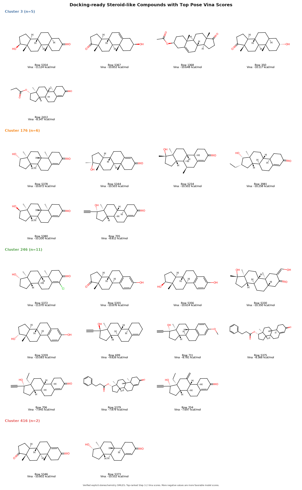
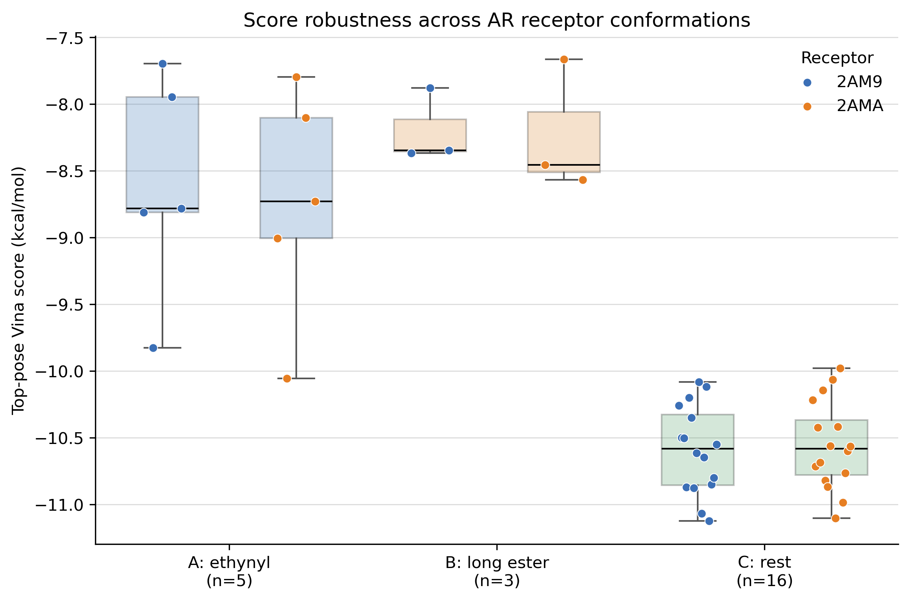
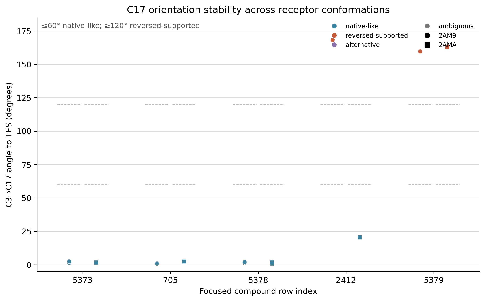
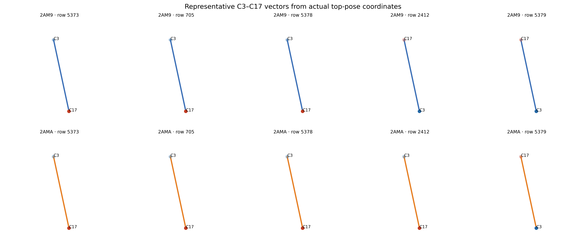

# From Bioactivity-Profile Clusters to Androgen Receptor Docking

**Exploring steroid C17 substitutions, predicted binding poses, and receptor-conformation sensitivity**

## Background: a pharmacological annotation worth investigating

This project follows up on [**Bioactivity Profile Distillation**](https://github.com/simpler2468/bioactivity-profile-distillation), which characterized chemical clusters using teacher-derived *in vitro* bioactivity profiles and pharmacological-association (PA) term annotations.

Four clusters—**3, 176, 246, and 416**—contained an association with the term **“Androgens.”** Crucially, **only one compound in each cluster carried that annotation**. This observation motivated us to further explore the AR-binding potential of these steroid-like compounds as candidate androgen agonists.

The compounds nevertheless showed steroid-like structural features, motivating a specific follow-up question:

> **Do other steroid-like compounds from these four clusters also have plausible predicted binding poses in the AR ligand-binding pocket? If so, which structural differences are associated with their docking behavior?**

We therefore used molecular docking to examine a shared target, the human AR ligand-binding domain (AR-LBD), and then analyzed the structural determinants of the resulting poses.

## From four clusters to 24 docked compounds

The initial set contained **47 chemical records** across the four clusters. Because steroid stereochemistry can substantially alter three-dimensional recognition, we retained only **24 compounds with sufficiently resolved stereochemistry** for docking and set aside the other 23 records rather than assigning arbitrary stereoisomers.

| Cluster | Docking-ready compounds |
|---|---:|
| 3 | 5 |
| 176 | 6 |
| 246 | 11 |
| 416 | 2 |
| **Total** | **24** |

We initially docked these 24 compounds into the testosterone-bound human AR crystal structure (**PDB 2AM9**) using AutoDock Vina. The receptor and native-ligand preparation were checked by crystal-pose redocking before screening the cluster-derived compounds.



## Finding 1: all four clusters contain compounds with plausible AR docking poses

**All 24 evaluated compounds received top-pose Vina scores below −5 kcal/mol in the 2AM9 receptor**, spanning approximately **−11.124 to −7.697 kcal/mol**. Thus, the docking model identified energetically favorable-scoring poses within the AR pocket for steroid-like compounds drawn from **all four clusters**, extending the structural hypothesis beyond the four individually annotated molecules.

A second observation emerged when we compared the molecular structures against their scores: **the substitution pattern around steroid carbon C17 was strongly associated with predicted docking behavior, across the original cluster boundaries.** This became the central focus of the project.

## Finding 2: three C17 substitution patterns show different docking behavior

We organized the 24 docked compounds into three **exploratory, post hoc** structural groups.

| C17-related structural group | n | Mean Vina score, 2AM9 (kcal/mol) | Mean Vina score, 2AMA (kcal/mol) |
|---|---:|---:|---:|
| Other steroid-like structures / reference patterns | 16 | −10.589 | −10.558 |
| **C17 ethynyl-substituted** | 5 | −8.612 | −8.738 |
| **C17 ester / extended ester** | 3 | −8.197 | −8.228 |

In the initial 2AM9 docking results, the eight compounds in the two highlighted C17 groups had **less favorable (less negative) scores than all 16 compounds in the reference group**, with no score-range overlap. This striking separation prompted geometric analysis rather than being assumed to reflect measured affinity.



### A. Smaller/reference C17 patterns: generally native-like steroid orientations

The 16-compound reference group comprised a heterogeneous set of steroid-like structures, with several representative members showing relatively compact and low-steric-hindrance C17 environments that more closely resembled native androgens. Compounds such as **Row 5373 and Row 5378** retained binding orientations close to the testosterone crystal pose, together with comparatively favorable scores under the tested Vina protocol.

### B. C17 ethynyl substitution: local packing changes without major core reversal

Five compounds carried the relevant C17 ethynyl-containing substitution pattern. In the representative comparison **Row 5373 vs Row 705**, the steroid cores occupied similar positions and the C3→C17 direction remained testosterone-like, despite a substantially less favorable score for Row 705.

Detailed contact analysis found additional close contacts around the C17 region. Importantly, their character depended on which atoms were considered and which receptor conformation was used:

- **Shared C17–OH region:** Row 705 had a sub-2.5 Å contact in **8/10** top poses with 2AM9 but **0/10** with 2AMA; Row 5373 had **0/10** under both receptors.
- **Ethynyl branch:** Row 705 showed sub-2.5 Å contacts in **7/10** (2AM9) and **6/10** (2AMA) top poses.

The matched comparison also contains a shared-core stereochemical difference, so the score change cannot be attributed exclusively to the ethynyl group.

### C. C17 ester substitution: alternative and sometimes reversed binding orientations

Three compounds carried C17 ester-related extensions. Their pose analyses revealed a different kind of effect: the orientation of the **steroid nucleus itself** could change within the same binding pocket.

Using validated **17-atom steroid-core mapping**, we identified C3 and C17 in each structure and compared the **directed C3→C17 vector** against the crystallographic testosterone orientation. This distinguished genuine head-to-tail pose changes from apparent RMSD differences due to atom ordering or ambiguous principal axes.

Two representative ester-containing compounds behaved differently:

| Representative compound | 2AM9 top poses | 2AMA top poses | Interpretation |
|---|---|---|---|
| **Row 2412** | Reversed, **10/10** seeds | Native-like, **10/10** seeds | Preferred docking orientation is **receptor-conformation-sensitive** |
| **Row 5379** | Reversed, **10/10** seeds | Reversed, **10/10** seeds | Reversed top-pose orientation was **reproducible across both tested receptors** |

In 2AM9, the average C3→C17 angle relative to testosterone was about **168°** for Row 2412 and **160°** for Row 5379. By contrast, the native-like reference compounds had angles of only a few degrees. The endpoint-swapping distances and pocket-residue proximity supported this classification.

C17 esterification showed a tendency to promote alternative binding orientations, including head-to-tail reversal in some cases. The outcome remained sensitive to receptor conformation: Row 2412 switched between native-like and reversed orientations across the two receptor structures, whereas Row 5379 adopted a reversed orientation in both. The wider docking outputs contained both native-like and reversed candidate poses, and the comparisons also involved changes in side-chain size, flexibility, and chemical functionality.





## Finding 3: which observations survive independent docking runs and another receptor conformation?

We assessed computational robustness at two levels:

**Search reproducibility.** Five representative compounds were docked with **10 independent random seeds per validated receptor**. The top-ranked orientation classifications were consistent within each tested receptor for the compounds described above. This quantifies search stability.

**Receptor-conformation sensitivity.** We repeated docking of the 24 compounds using the DHT-bound human AR structure (**PDB 2AMA**) after successful native-ligand validation. The two receptors produced highly consistent rankings (**Spearman ρ = 0.937, n = 24**), and the C17-related score-group trends remained similar. However, **Row 2412 changed its preferred orientation**, demonstrating that score trends and detailed binding modes do not have identical sensitivity to receptor geometry.

A third candidate structure (**PDB 2AMB**, THG-bound AR) was investigated but **excluded**. Its MET895 region contained problematic backbone/alternate-location geometry; candidate repairs could not simultaneously satisfy geometric integrity and preserve the experimental coordinates. The final status was **`not_validated`**, and its docking results were not included or substituted with a forced repair.

### Validation summary

| Check | Outcome |
|---|---|
| 2AM9 testosterone crystal-pose redocking | Mean heavy-atom RMSD ≈ **0.227 Å** across five seeds |
| 2AMA DHT crystal-pose redocking | Mean heavy-atom RMSD ≈ **0.297 Å** across five seeds |
| 2AM9 24-compound docking | **24/24** top poses obtained |
| 2AMA 24-compound docking | **24/24** top poses obtained |
| Cross-receptor score ranking | **Spearman ρ = 0.937** |
| 2AMB structural QC | **Not validated; excluded** |

## Overall interpretation

The original **Androgens** annotations supplied a pharmacological clue rather than a direct AR-binding label. The docking follow-up found plausible predicted poses for all 24 stereochemically resolved compounds from four clusters and highlighted **C17 substitution** as a useful structural axis for explaining differences in predicted AR docking behavior.

Within the tested docking protocol, **ethynyl-related variants tended to retain native-like steroid-core orientations with altered local contacts**, whereas **some ester-related variants adopted head-to-tail reversed top poses whose preference could depend on the receptor conformation**. The score-group trend was comparatively stable across two validated AR structures, even when the detailed pose orientation was not.

## Computational workflow and reproducibility

```mermaid
flowchart LR
    A[Bioactivity-profile clustering and PA annotations] --> B[Four Androgens-associated clusters]
    B --> C[47 records: stereochemistry curation]
    C --> D[24 docking-ready compounds]
    D --> E[AR preparation and native-ligand redocking]
    E --> F[Vina docking and C17 structure comparison]
    F --> G[C3/C17 pose mapping and 10-seed checks]
    G --> H[2AM9 vs 2AMA receptor sensitivity]
```



The workflow uses **RDKit**, **PDBFixer/OpenMM**, **Meeko**, **AutoDock Vina 1.2.7**, Python-based geometric analysis, and PyMOL-oriented molecular visualization. Both validated receptors were aligned to a common frame. The standardized Vina box for the main comparison was centered at `(27.186, 2.704, 5.234) Å` with size `(18, 21, 16) Å`, using `exhaustiveness=16` and up to 10 output modes. Full run parameters, atom maps, QC decisions, and pose records are retained in the local full-project directory; the compact release publishes the key summary tables and figures.

For the **analysis-only** entry point, use the provided environment specification:

```bash
conda env create -f environment.github.yml
conda activate steroid_docking
python run_analysis_only.py
```

**Note:** `run_analysis_only.py` defaults to a `summary-only` mode that regenerates compact score, orientation, and H3 summaries from the published CSV/JSON tables; it does **not** run docking. Use `python run_analysis_only.py --mode full` only when the local pose files from the complete workflow are available. Reproducing docking from raw input requires the stage-specific scripts, documented receptor/ligand preparation steps, and the reviewed external structure/data inputs.

### Project structure

```text
data/                    Local raw/prepared inputs (not included in the compact release)
scripts/                 Receptor/ligand preparation, docking, QC, and analysis
results/                 Curated numerical summaries (full pose files remain local)
figures/final/           Curated scientific figures
reports/                 Final project summary and interpretation
environment.github.yml   Public-facing Conda environment
run_analysis_only.py     Analysis-only reproduction entry point
```

## Limitations and provenance

The PA annotations do not establish that cluster members bind or activate AR. The selection of C17 structural groups followed inspection of the initial docking results, and some comparisons include additional structural or stereochemical changes. Vina scores are approximate scoring-function outputs, **not** experimentally determined binding free energies; a score below −5 kcal/mol is **not** a validated binder classification. Rigid-receptor docking omits protein conformational dynamics. Multi-seed agreement establishes computational search reproducibility, while only **two receptor conformations** passed QC. Close heavy-atom contacts are geometric descriptors, not automatically hydrogen bonds or steric clashes. No claims of experimental AR affinity, agonism/antagonism, or receptor selectivity are made.

**Upstream project:** [bioactivity-profile-distillation](https://github.com/simpler2468/bioactivity-profile-distillation) – source of the bioactivity-cluster/PA-term investigation motivating this work. Protein coordinates and chemical component information are sourced from the **RCSB Protein Data Bank** ([2AM9](https://www.rcsb.org/structure/2AM9), [2AMA](https://www.rcsb.org/structure/2AMA), [2AMB](https://www.rcsb.org/structure/2AMB)). Software used includes AutoDock Vina, Meeko, RDKit, PDBFixer/OpenMM, and the Python scientific stack; see [`docs/methods.md`](docs/methods.md) for the compact protocol and the local full-project reports for detailed QC records.

